# AWS VPC Peering Project

**Connect two VPCs and prove private connectivity** using EC2, custom route tables, security groups and a bastion host.

| | |
|---|---|
| **Student** | Kaif Ali Khan |
| **Batch** | Batch 1 |
| **Course** | EWB Courses, AWS Architect Associate |
| **Region** | ap-south-1 (Mumbai) |
| **Tools** | AWS CLI v2, Bash, Python 3 (reportlab, pillow) |

---

## Overview

Two private application servers live in two different VPCs. They must stay private (no public IP) yet talk to each other over private IPv4. This project builds that with **VPC peering**, administers the servers through a single **bastion host** (SSH ProxyJump), and proves every claim with evidence: a failing test before peering, passing tests after, and a controlled failure with recovery.

**Everything is automated with shell scripts**, from build to tests to cleanup.

## Architecture

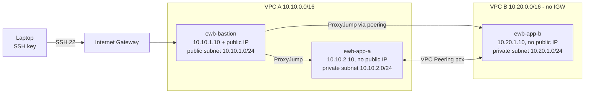

| Resource | CIDR / IP |
|---|---|
| VPC A (`ewb-vpc-a`) | 10.10.0.0/16 |
| Public subnet `ewb-a-public` | 10.10.1.0/24 |
| Private subnet `ewb-a-private` | 10.10.2.0/24 |
| VPC B (`ewb-vpc-b`) | 10.20.0.0/16 |
| Private subnet `ewb-b-private` | 10.20.1.0/24 |
| Instances | bastion 10.10.1.10, app-a 10.10.2.10, app-b 10.20.1.10 (all t3.micro, Amazon Linux 2023) |

CIDRs do not overlap, which is a hard requirement for peering.

## Route tables

| Route table | Destination | Target | Purpose |
|---|---|---|---|
| ewb-rt-a-public | 10.10.0.0/16 | local | VPC A internal |
| | 0.0.0.0/0 | Internet gateway | Bastion internet access |
| | 10.20.0.0/16 | Peering | Bastion SSH to App-B |
| ewb-rt-a-private | 10.10.0.0/16 | local | VPC A internal |
| | 10.20.0.0/16 | Peering | Forward path to VPC B |
| ewb-rt-b-private | 10.20.0.0/16 | local | VPC B internal |
| | 10.10.0.0/16 | Peering | Return path to VPC A |

## Security groups (least privilege)

| Security group | Inbound rule | Source |
|---|---|---|
| ewb-sg-bastion | SSH 22 | My public IP /32 |
| ewb-sg-app-a | SSH 22 | 10.10.1.10/32 (bastion) |
| ewb-sg-app-a | ICMP echo request | 10.20.1.10/32 (App-B) |
| ewb-sg-app-b | SSH 22 | 10.10.1.10/32 (bastion) |
| ewb-sg-app-b | ICMP echo request | 10.10.2.10/32 (App-A) |

No `0.0.0.0/0` for SSH or ICMP. Private hosts have no public IP. Security groups are stateful, outbound is default allow-all.

## Test results

| Test | What it proves | Result |
|---|---|---|
| 01 Baseline (before peering) | App-A cannot reach App-B | 100% packet loss |
| 02 Forward path | App-A pings App-B | 0% loss |
| 03 Reverse path | App-B pings App-A (return route works) | 0% loss |
| 04 Private SSH | Laptop to App-B through bastion | Shell reached |
| 05 Isolation | App-A and App-B have no public IPv4 | `None` |
| Controlled failure | Remove ICMP rule on App-B SG | 100% loss, then 0% after restore |

The controlled failure shows that an **Active peering is only the link**: routes and security groups at the destination still decide whether traffic flows.

Raw outputs are in [`evidence/`](evidence/).

## Screenshots

| | |
|---|---|
| 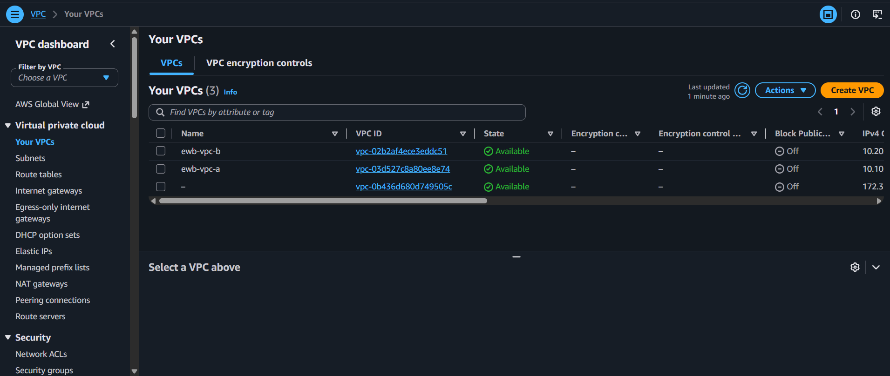 | 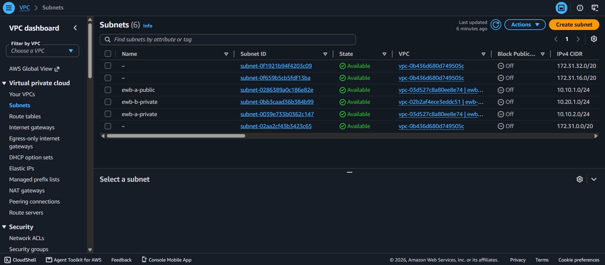 |
| **VPCs** | **Subnets** |
| 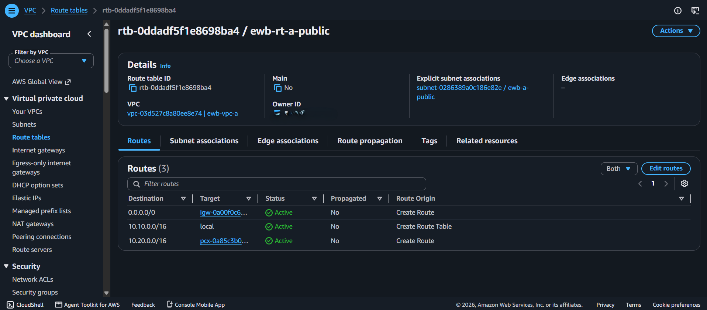 | 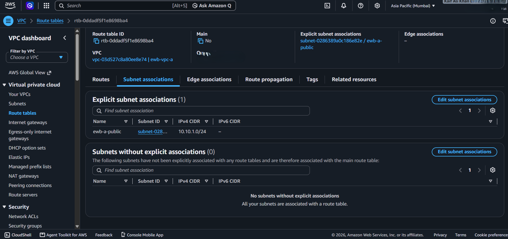 |
| **Public route table: routes** | **Public route table: associations** |
| 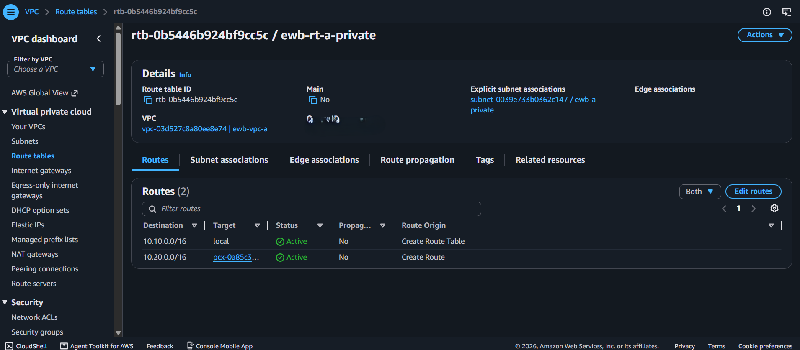 | 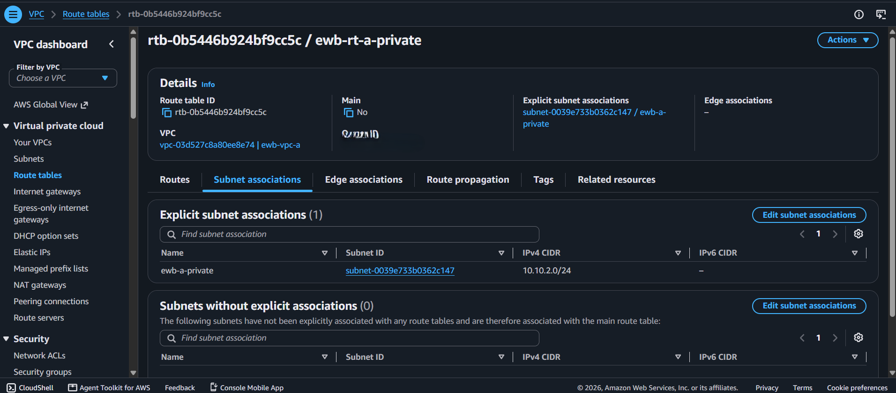 |
| **Private A route table** | **Private A associations** |
| 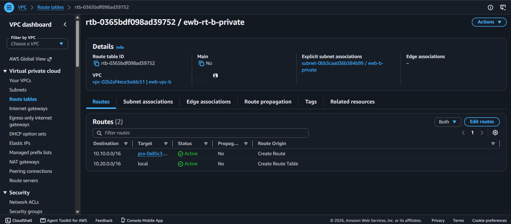 | 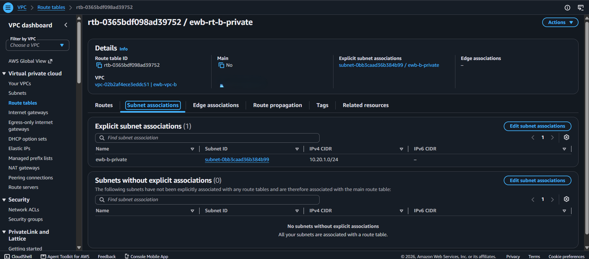 |
| **Private B route table** | **Private B associations** |
| 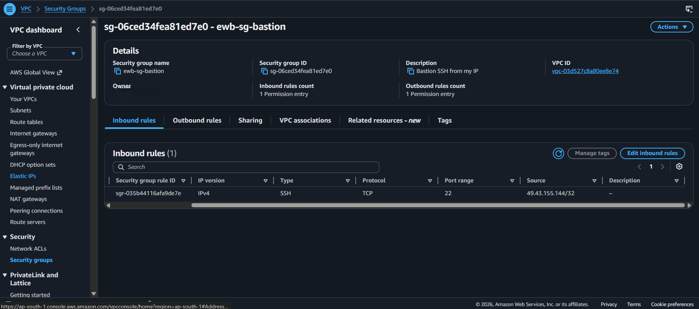 | 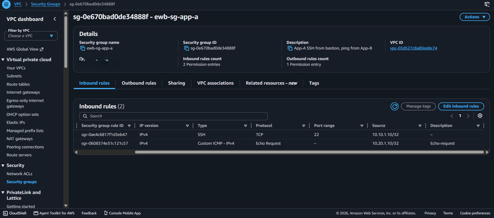 |
| **Bastion security group** | **App-A security group** |
| 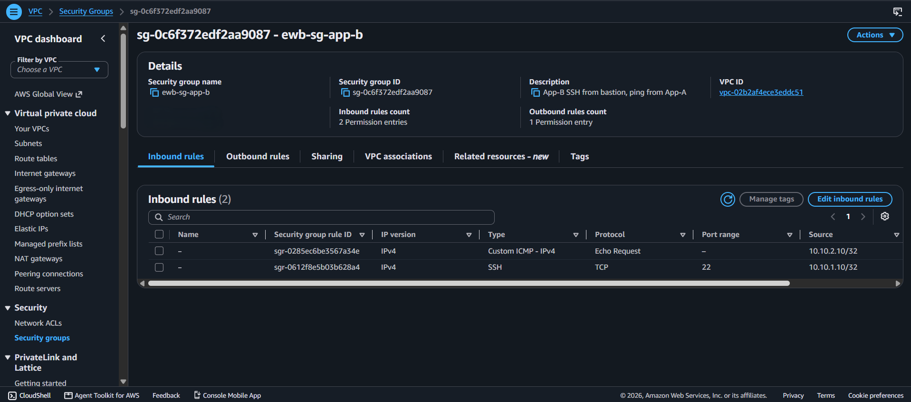 | 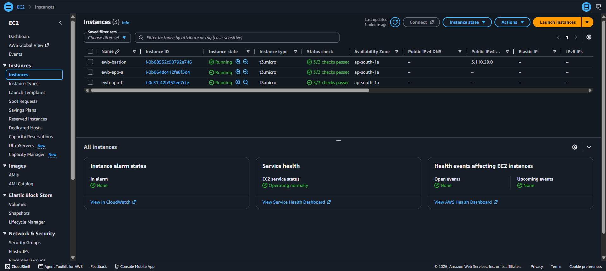 |
| **App-B security group** | **Instances** |
| 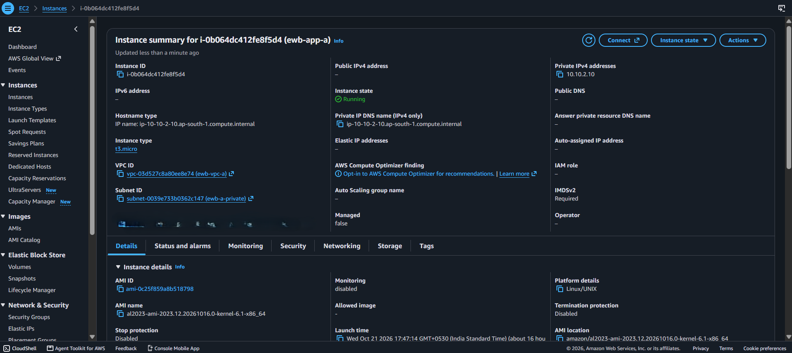 | 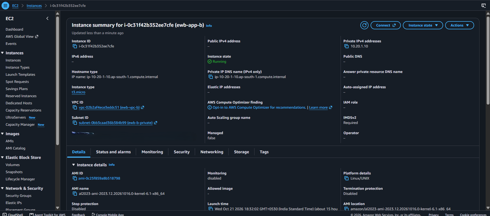 |
| **App-A: no public IP** | **App-B: no public IP** |
| 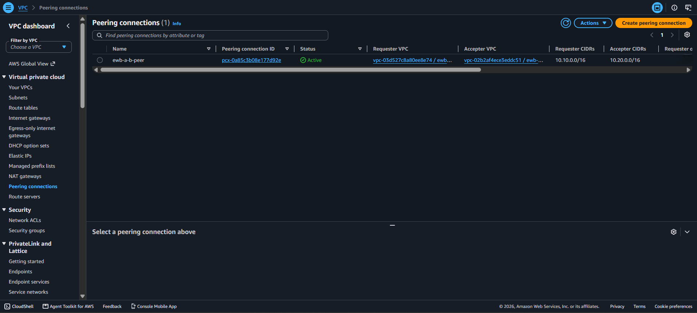 | 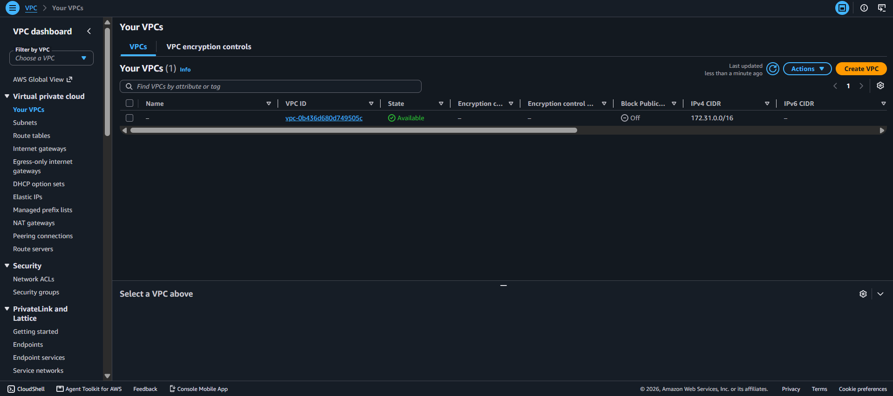 |
| **Peering connection Active** | **After cleanup: only default VPC left** |

## How to run

**Prerequisites:** Linux, macOS or Windows WSL (Ubuntu), AWS CLI v2, Python 3, and `pip install reportlab pillow`.

1. Create an IAM user with `AmazonEC2FullAccess` and `AmazonVPCFullAccess`, create a CLI access key, then run `aws configure` (region `ap-south-1`, output `json`).
2. Create `config.env` with your details:
```bash
   STUDENT="Your Name"
   BATCH="Your Batch"
   REGION="ap-south-1"
   INSTANCE_TYPE="t3.micro"
```
3. `chmod +x *.sh`

| # | Command | What it does |
|---|---|---|
| 1 | `./01-deploy.sh` | Builds both VPCs, subnets, IGW, route tables, security groups, key pair and 3 EC2 instances |
| 2 | `./02-ssh-setup.sh` | Writes `~/.ssh/config`, tests bastion and App-A |
| 3 | `./03-baseline-test.sh` | Test 01: ping fails before peering |
| 4 | `./04-peering.sh` | Creates and accepts peering, adds the 3 routes |
| 5 | `./05-verify.sh` | Tests 02 to 05 and the controlled failure |
| 6 | `./06-inventory.sh` | Saves inventory evidence |
| 7 | `python3 make_report.py` | Builds the PDF report (needs console screenshots in `screenshots/`) |
| 8 | `./99-cleanup.sh` | Deletes everything and saves cleanup proof |

## Troubleshooting (issues I actually hit)

- **Bastion SSH times out:** my public IP changed. Run `./fix-my-ip.sh`.
- **Ping still works after removing the ICMP rule:** a second, broader ICMP rule existed on the security group. List rules with `aws ec2 describe-security-group-rules` and remove the extra one.
- **One instance missing after deploy:** the script continued past a failed launch. Check instances, then launch the missing one with the same subnet, IP and security group.
- **`AccessDenied` on `ssm:GetParameter`:** the IAM user has only EC2 and VPC policies. Use the AMI ID saved by the deploy script instead.
- **Script stops halfway:** read the error, run `./99-cleanup.sh` and start again.

## What I learned

A working peering needs three things together: an **Active peering**, **routes on both sides**, and **matching security group rules**. A bastion lets me administer private servers without public IPs or copying keys onto them. Testing a failure before and after a change proves each component does a real job. Cleaning up promptly avoids surprise charges.

## Cost and cleanup

Everything ran on an AWS Free plan with credits. `./99-cleanup.sh` removed all resources (instances, volumes, peering, security groups, subnets, IGW, VPCs, key pair), verified by empty lists in `evidence/30-cleanup.txt`.

## Security notes

Never commit `.pem` files, `ids.env`, `config.env` or AWS access keys. They are excluded through `.gitignore`.
